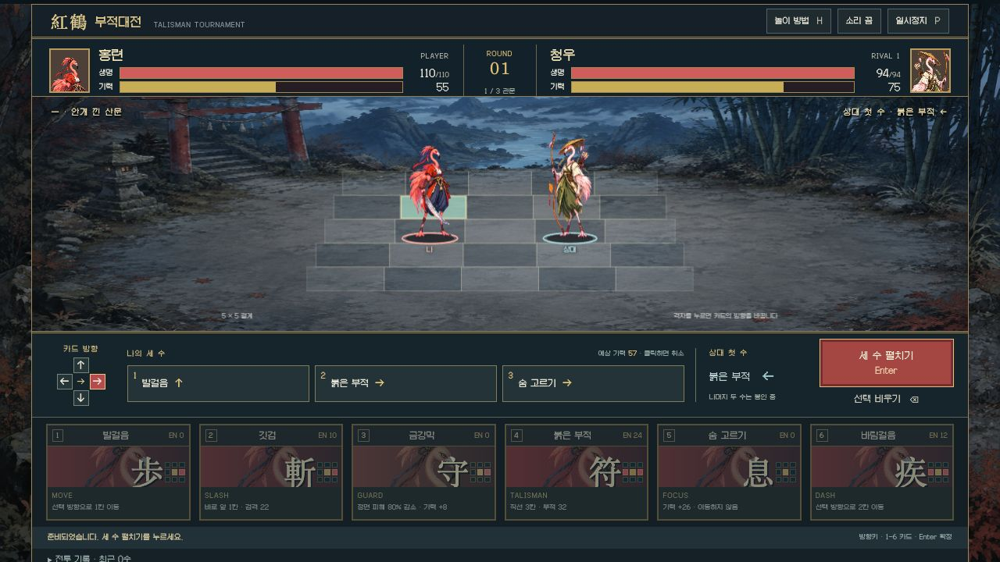
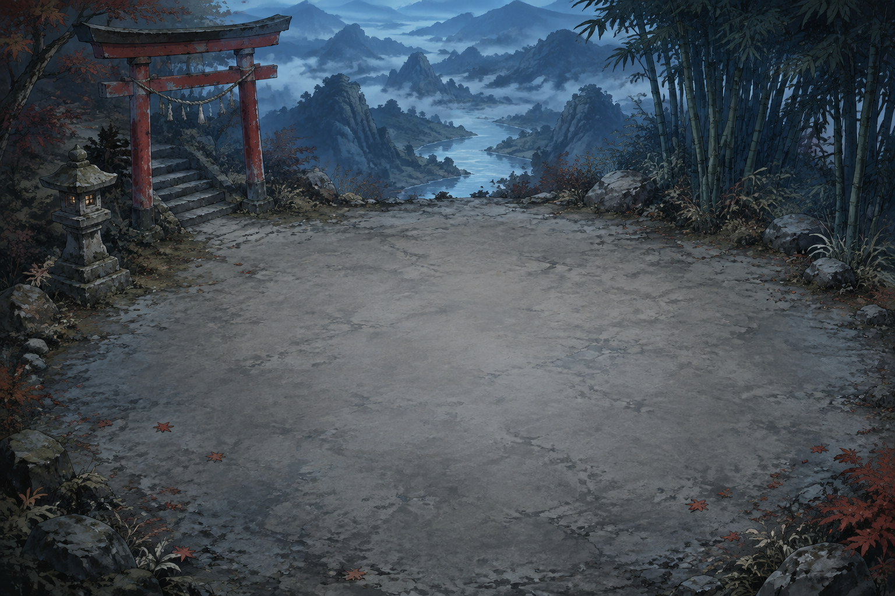
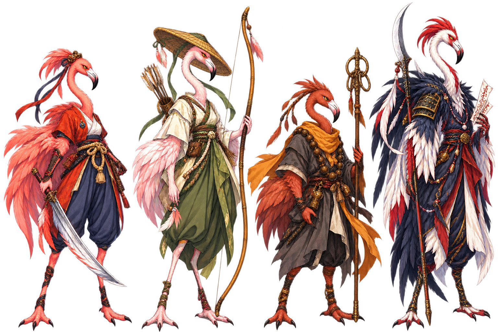

# 홍학 부적대전

**Flamingo Talisman — 새벽의 결계**

세 수를 먼저 고르고, 동시에 펼치는 독립 카드 전술 게임입니다. 5×5 결계 위에서 홍련·청우·묵진·백야 중 한 명을 골라 나머지 세 전사와 겨룹니다. 다른 미니게임의 공통 렌더러나 선택 화면을 쓰지 않습니다.



[게임 소스](src/) · [실제 플레이 검증](docs/browser-qa.md) · [원화 제작 기록](docs/assets.md)

<table>
  <tr>
    <td width="50%"></td>
    <td width="50%"></td>
  </tr>
  <tr><td><b>새벽의 결계</b><br />붉은 산문·대나무·수묵 산수의 독립 전투 무대</td><td><b>네 명의 전사</b><br />각자의 생명·기력·검격·부적·방어 특성</td></tr>
</table>

위 이미지는 게임에 포함된 원화 자산입니다. 실행 화면 캡처를 대신하는 검증 증거가 아닙니다.

## 실행

Node.js 22.12 이상이 필요합니다. 서버·계정·API 키·Sites 없이 로컬에서 실행합니다.

```sh
npm ci
npm run dev
```

브라우저에서 [로컬 대전 열기](http://127.0.0.1:4202)를 엽니다. 포트 4202가 사용 중이면 다른 포트로 조용히 바꾸지 않고 종료합니다.

```sh
npm test
npm run build
npm run preview
```

현재 CPU 테스트 **49개**가 통과합니다. 규칙·대진·좌표 검사 외에 `P → H → Escape` 후 정지가 유지되는지, 도움말을 반복해서 열어도 원래 실행 상태를 잃지 않는지 검사합니다. [자동 검증 기록](docs/verification.md)은 [실제 브라우저 점검](docs/browser-qa.md)과 구분합니다.

## 조작

| 조작                          | 기능                          |
| ----------------------------- | ----------------------------- |
| 방향키 / 방향판 / 전투판 클릭 | 다음 카드의 방향 선택         |
| 1–6 / 카드 클릭               | 세 수의 계획에 행동 추가      |
| 계획의 카드 클릭 / Backspace  | 해당 수 취소 / 마지막 수 취소 |
| Enter                         | 세 수 확정 및 동시 전투       |
| P / Escape                    | 일시정지·계속                 |
| H                             | 놀이 방법                     |

계획에는 시간 제한이 없습니다. 상대의 **첫 번째 실제 카드와 방향**만 공개되며, 나머지 두 수는 확정 전 보이지 않습니다. 상대 AI는 플레이어의 선택 큐를 받지 않습니다.

## 규칙

- 발걸음: 지정 방향 1칸. 바람걸음: 기력 12를 써서 2칸. 상대를 통과하지 않습니다.
- 깃검: 바로 앞 한 칸에 22 피해, 홍련은 +3. 붉은 부적: 직선 세 칸에 32 피해, 청우 +5·백야 +3.
- 금강막: 정면 피해 80% 감소, 작은 반격, 기력 +8. 뒤에서 들어오는 공격은 막지 못합니다.
- 숨 고르기: 기력 +26. 기력은 최대 100이며 매 라운드 끝에 +5입니다.
- 한 수는 **양쪽 이동 → 방어/회복 → 양쪽 공격** 순서입니다. 공격은 동시에 판정되어 동시 쓰러짐도 가능합니다. 같은 도착 칸은 서로 양보하여 둘 다 멈춥니다.
- 30라운드가 지나면 남은 생명 비율을 비교합니다. 승리하면 다음 관문에서 생명과 기력을 회복합니다. 세 관문을 넘으면 엔딩입니다.
- 창이 비활성화되면 진행 중인 세 수도 정지하며 플레이어가 계속하기를 눌러야 재개됩니다. 도움말은 열기 직전의 실행·정지 상태를 보존합니다. 실행 중 열었다가 닫으면 원래 수의 진행으로 돌아가고, 이미 정지한 상태였다면 닫아도 정지가 유지됩니다.

## 참고와 권리

이누야샤 데몬 토너먼트의 다중행 전투판·행동 카드·상단 대칭 HUD를 참고한 **비공식 홍학 패러디**입니다. 원작의 SWF·캐릭터·로고·음성·음악·이미지를 게임에 포함하지 않습니다. 원작과 동일한 규칙, 공식 후속작 또는 복원판이라고 주장하지 않습니다.

새 배경과 네 전사의 원화는 내장 이미지 생성 도구로 제작했습니다. 전투판에서는 크로마키 스프라이트를 실제 행동·방향·피해와 함께 그립니다. 글꼴 Galmuri11은 포함된 [SIL Open Font License](public/fonts/OFL.md)를 따릅니다. 효과음은 Web Audio로 직접 합성합니다.

| 더 보기                                                                   | 내용                                   |
| ------------------------------------------------------------------------- | -------------------------------------- |
| [시각 참고·설계 결정](docs/design.md)                                     | 직접 확인한 원작 화면과 새 구현의 차이 |
| [자산 제작 기록](docs/assets.md)                                          | 생성 프롬프트, 파일, 런타임 처리       |
| [검증 범위](docs/verification.md)                                         | CPU 테스트와 브라우저 검증의 구분      |
| [플라밍고 오락실 02](https://github.com/minwoo19930301/flamingo-arcade-2) | 이전 모음집 — 이 게임은 별도로 실행됨  |

## 코드 구조

- `src/engine.mjs`: DOM 없는 전투 규칙·예측·유한 AI·토너먼트
- `src/render.mjs`: 원화 스프라이트·원근 전투판·범위·검격/부적 시각화
- `src/main.mjs`: 독립 화면과 입력·소리·일시정지 수명주기
- `tests/`: 규칙·장기 대전·전투판 좌표·크로마키 회귀 테스트

CI는 테스트와 빌드만 수행합니다. 배포 작업은 없습니다.
